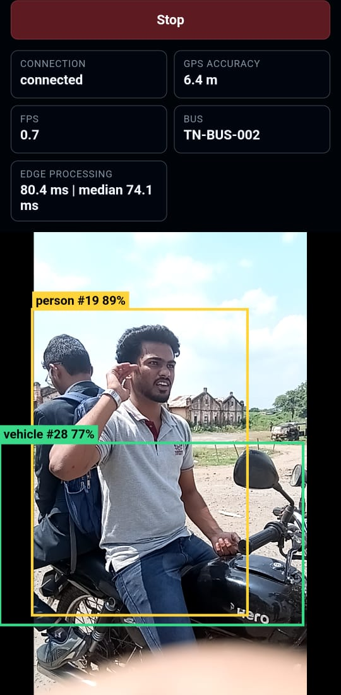
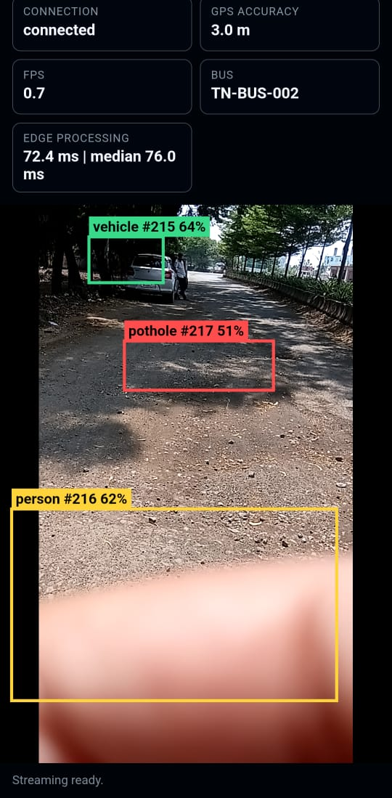
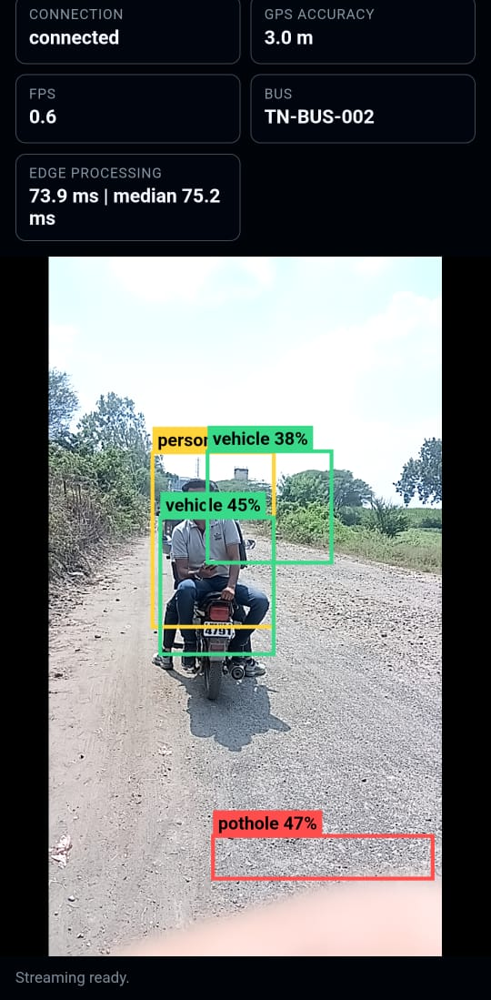
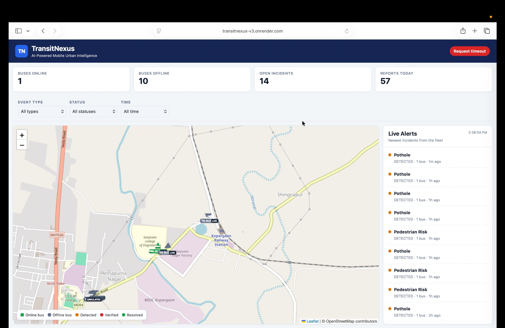
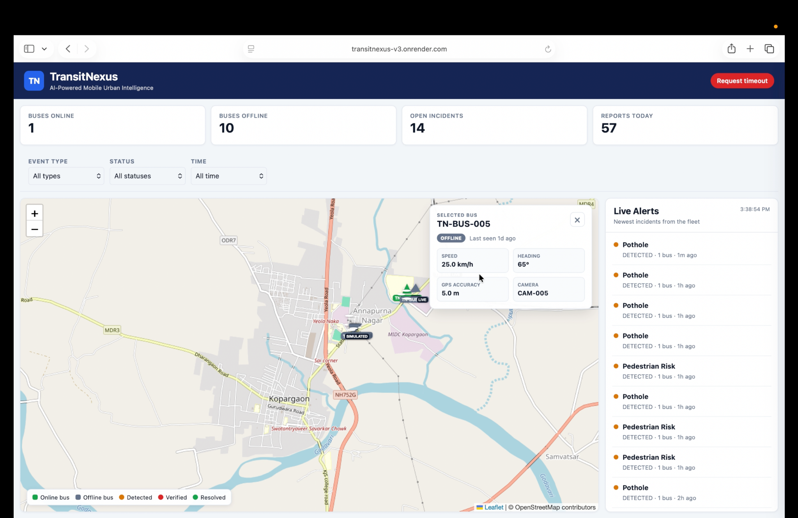
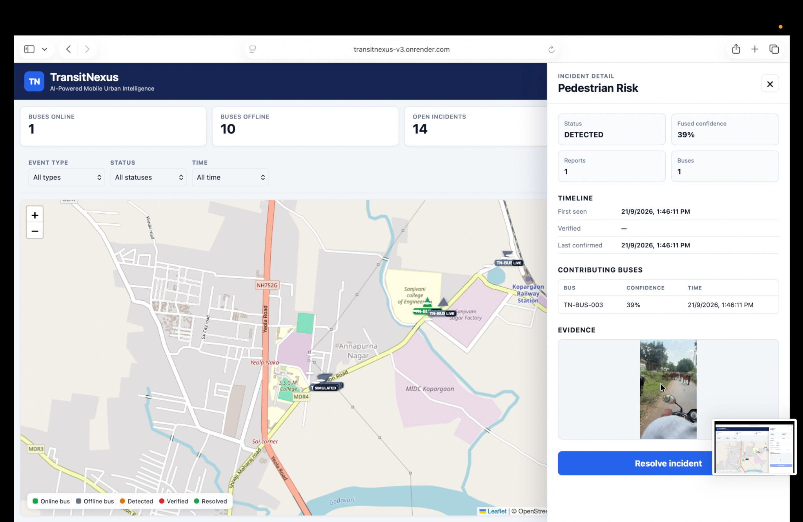
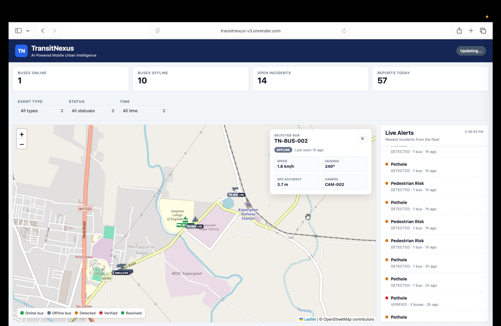

# TransitNexus

**AI-Powered Mobile Urban Intelligence Platform Using Public Transport Fleet**

TransitNexus turns public-transport buses into mobile sensing units. A phone camera and GPS feed an edge-processing pipeline that generates structured, location-aware reports for road hazards and pedestrian risk. Reports are sent to a cloud backend, where the system applies multi-bus deduplication and presents fleet and incident information on a GIS control-center dashboard.

> **Smart India Hackathon 2026 — Round 3 Submission**
> Problem Statement: **SIH26124** · Theme: **Smart Automation** · Category: **Software**
> Sponsor: **Bharat Electronics Limited (BEL)** · Team: **TransitNexus** (Team ID 165934)

[](https://github.com/ajeetsherkar/transitnexus-sih/actions)

**Live Control Center:** https://transitnexus-v3.onrender.com/dashboard/
**Backend API docs:** https://transitnexus-v3.onrender.com/docs
**Demo video:** _[add link]_

---

## The Problem

1. Urban authorities cannot continuously monitor road conditions across large, complex road networks in real time.
2. Public-transport buses already carry cameras and travel extensively across a city every day, but this video is largely unused for real-time road and incident monitoring.
3. Delayed identification of exact hazard locations slows maintenance, emergency response, and road-safety action.

## Our Solution

TransitNexus uses cameras and GPS on public-transport vehicles to generate structured, location-aware event reports. The current prototype demonstrates this workflow with smartphone-based sensing and a laptop edge node.

```text
Video → AI Detection → Structured Events → GIS + ML Intelligence → Actionable Dashboard
```

| | Prototype (what is built and running) | Production target |
|---|---|---|
| Sensing | Live smartphone camera + real-time GPS acting as the bus device | Live bus-mounted camera + vehicle GPS unit |
| Compute | Edge AI on a laptop edge node | On-bus edge computer (Jetson-class / rugged) |
| Backend | Deployed FastAPI + Postgres cloud backend | Same backend, scaled fleet |
| Dashboard | Live GIS control center | Same, with authority-facing workflows |

**Why TransitNexus:**
- Reuses the existing bus fleet — no new fixed sensing network to install
- Converts detections into structured, location-aware event reports rather than relying on raw video alone
- Merges reports that satisfy the system's type-aware, spatial, and temporal matching rules into a shared incident record
- Scales from one phone to a full fleet without redesigning the pipeline

---

## Live Architecture

```text
┌─────────────┐  ┌─────────────┐  ┌─────────────┐
│  Phone 1    │  │  Phone 2    │  │  Phone 3    │
│ TN-BUS-001  │  │ TN-BUS-002  │  │ TN-BUS-003  │
│ Camera+GPS  │  │ Camera+GPS  │  │ Camera+GPS  │
└──────┬──────┘  └──────┬──────┘  └──────┬──────┘
       │                │                │
       └────────────────┼────────────────┘
                         │  HTTPS / WebSocket
                         ▼
              ┌───────────────────────┐
              │  Cloudflare Tunnel    │   exposes the local
              │  (*.trycloudflare.com)│   edge server to phones
              └───────────┬───────────┘
                          │
                          ▼
              ┌───────────────────────┐
              │   Local Edge Server   │   runs on a laptop today;
              │                       │   Jetson-class device in
              │  YOLOv8 detection     │   production
              │  ByteTrack tracking   │
              │  Event engine         │
              │  Evidence generation  │
              │  SQLite offline outbox│
              └───────────┬───────────┘
                          │  HTTPS REST (events, heartbeat)
                          ▼
              ┌───────────────────────┐
              │  TransitNexus Backend │   deployed on Render
              │  (FastAPI)            │
              │  Per-bus API-key auth │
              │  Dedup engine         │
              │  Incident lifecycle   │
              └───────────┬───────────┘
                          │
                          ▼
                  ┌───────────────┐
                  │   PostgreSQL  │
                  └───────┬───────┘
                          │
                          ▼
              ┌───────────────────────┐
              │   Control Center      │   Leaflet dashboard,
              │   (/dashboard/)       │   served by the backend
              │  Fleet + trails       │
              │  Incidents + evidence │
              │  Filters + zones      │
              └───────────────────────┘
```

**Where each piece runs:**

| Component | Location | Purpose |
|---|---|---|
| Mobile client | Phone (browser) | Camera + GPS sensing, no app install needed |
| Cloudflare Tunnel | Internet | Exposes the local edge server to phones over HTTPS (required for camera/GPS permissions) |
| Edge server | Local laptop today | ML inference, tracking, event generation, offline outbox |
| FastAPI backend | Render (cloud) | Authentication, ingestion, deduplication, incident lifecycle, API |
| Database | Render-hosted Postgres | Persistent buses, positions, reports, incidents |
| Control Center | Render, served at `/dashboard/` | Fleet map, live alerts, filters, incident detail, evidence |

The phone streams camera frames to the local edge server for processing. Raw video is not sent to the cloud backend. The edge-to-cloud uplink sends structured event reports, heartbeats, and selected evidence images. This distinction is important: video is transmitted from the phone to the edge node, while the cloud receives event-oriented data.

---

## Technical Approach

| Layer | What it does | Technologies |
|---|---|---|
| 1. Mobile Sensing | Phone camera + GPS act as the bus device | Camera, GPS, Bus ID, WebSocket |
| 2. Edge AI | Detects and tracks road hazards, vehicles, and pedestrians | YOLOv8, OpenCV, ByteTrack, Event Engine |
| 3. Connectivity | Gets phone data to the edge node and events to the cloud reliably | Cloudflare Tunnel, SQLite Outbox, Retry/Backoff |
| 4. Cloud Intelligence | Authenticates, validates, and deduplicates incoming reports | FastAPI, Ingestion API, Dedup Engine, Incident Verification |
| 5. GIS Control Center | Presents fleet and incidents to an operator | Leaflet, Fleet Monitoring, Incident Detail, Evidence |

**Core technologies:** Python · Ultralytics (YOLOv8) · FastAPI · WebSocket · SQLite · PostgreSQL · Leaflet

Each layer runs independently — a single bus camera can generate structured events today, while the same pipeline scales to a full fleet without redesign.

---

## Key Features

### 1. Live Phone-Based Sensing
A phone's rear camera and GPS act as a bus's camera and GPS unit — no dedicated hardware needed to validate the pipeline. Frames stream to the edge server over a secure WebSocket; GPS updates (lat, lon, accuracy, speed, heading) stream alongside them.

### 2. Edge Detection and Tracking
YOLOv8 detects road hazards, vehicles, and pedestrians on each frame. ByteTrack assigns a stable track ID to each object across frames, so one pothole or one pedestrian is counted once, not once per frame.

### 3. Structured Event Generation
Confirmed detections (not raw per-frame boxes) become events, each with an event type, confidence, GPS location, timestamp, bus/camera ID, and a small evidence image.

### 4. Multi-Bus Deduplication
The core Round-3 capability: when multiple buses report the same real-world incident, TransitNexus merges them into a single incident record instead of creating duplicate alerts.

- **Type-aware matching** — different rules for a static hazard (pothole) vs. a transient one (pedestrian risk)
- **Spatial matching** — a distance radius that widens with the reporting phone's GPS accuracy, since phone GPS is typically off by 5–20 m
- **Temporal matching** — reports must fall within a type-specific time window
- **Same-bus guard** — a bus re-reporting the same spot doesn't inflate the confirming-bus count
- **Confidence fusion** — merged confidence is computed across all contributing buses' best detections

**Recorded deduplication test results:**

| Test | Reports submitted | Result |
|---|---|---|
| Simulated fleet, single pothole | 14 reports from 10 simulated buses | Collapsed to **1 incident**, `bus_count: 10`, status `VERIFIED` |
| Real-device field test, single pothole | 44 reports from 3 physical phones | Collapsed to **1 incident**, `bus_count: 3`, status `VERIFIED` |

### 5. Incident Lifecycle
Incidents move through `DETECTED` (one reporting bus) → `VERIFIED` (reports from at least two distinct buses satisfy the deduplication rules) → `RESOLVED` (operator action). Here, `VERIFIED` means corroborated by the system's multi-bus rule; it does not mean independently confirmed by a human or ground-truth inspection. A new detection at a resolved location opens a new incident linked as a **recurrence**.

### 6. Reliable Uplink (Offline Queue)
Events are written to a local SQLite outbox before being sent. If the network drops, the uplink thread retries with exponential backoff; events are idempotent on `event_id`, so retries never create duplicates. A dead-letter table catches requests that can never succeed (e.g. bad auth) so they don't block the queue.

### 7. Per-Bus Authentication
Every bus/phone authenticates with its own API key (stored server-side only as a hash). A key that doesn't match its claimed `bus_id` is rejected. Read endpoints require a separate read token so the live data isn't publicly scrapeable.

### 8. GIS Control Center Dashboard
- Live fleet map: bus markers (online/offline), bus trails, follow-bus mode
- Live incident markers, colour-coded by status, with type icons
- KPI strip: buses online/offline, open incidents, reports today
- Filters by bus, route, event type, severity, status, time window
- Incident detail panel: status timeline, contributing buses, fused confidence, evidence image
- Access-code overlay so the live dashboard isn't open to anyone with the link

### 9. Multi-Bus Fleet Simulator
`tools/simulate_fleet.py` drives simulated buses along real drawn routes with realistic GPS noise, for testing and demoing fleet-scale behaviour (including the same-pothole dedup scenario) without needing physical devices every time.

---

## Honest Performance Numbers

The figures below describe different experiments and should not be interpreted as one end-to-end performance measurement.

| Measurement | Recorded result | Scope and limitation |
|---|---:|---|
| Historical live edge-processing sample | 74.7 ms sample; 76.9 ms rolling median | A7 field measurement dated 2026-09-20 |
| Historical capture/response rate | Approximately 2.0 FPS | Field measurement; not a guaranteed sustained rate or a phone-to-dashboard latency figure |
| Pothole model precision | 78.2% | Model-card test set: 97 images and 292 ground-truth instances |
| Pothole model recall | 67.4% | Same test-set evaluation |
| Pothole model mAP@50 | 74.3% | Same test-set evaluation |
| Pothole model mAP@50–95 | 38.4% | Same test-set evaluation |
| Simulated deduplication | 10 simulated buses → 1 incident | Controlled fleet simulation |
| Physical-device deduplication | 3 phones, 44 reports → 1 incident | Recorded field test |

**What the latency number measures:** the edge timer covers `process_frame()`, including the sequential YOLO detection/tracking calls and event-engine processing. It excludes phone-side JPEG encoding, edge-side JPEG decoding, evidence-image encoding, SQLite outbox handling, cloud delivery, backend ingestion, and dashboard polling. Therefore, it is an edge-processing measurement—not complete inference-to-dashboard latency.

**What the frame-rate number means:** approximately 2.0 FPS was recorded in a historical field measurement. The browser client uses a capture/response loop with a busy lock, so its configured polling interval is not a guarantee of sustained FPS. A separate 0.2–0.9 FPS figure has no sufficiently established measurement provenance and is not presented as a verified result here.

**Model-evaluation limitation:** the model-card test set is small, and 48 test images share a filename-derived source identifier with training images. The evaluation is therefore not source-independent. Precision and mAP are dataset metrics, not guarantees of field accuracy.

**End-to-end latency:** phone-to-dashboard latency has not yet been measured with a controlled, timestamped end-to-end experiment. We therefore do not claim that incidents consistently appear within a specified number of seconds.

**Hardware:** the live edge measurements were taken on a laptop-based prototype. Jetson-class or rugged on-bus hardware is a production target, not hardware validated by these measurements.

## Real vs Simulated vs Production

| Component | Current state | Evidence / interpretation | Production plan |
|---|---|---|---|
| Phone camera stream + edge processing | **Real, live prototype** | Physical phones stream to a laptop edge server | Integrate bus-mounted camera with an on-bus edge computer |
| Pothole detection | **Real model, limited evaluation** | Model-card test set: precision 78.2%, recall 67.4%, mAP@50 74.3%; small test set with source overlap | Collect a larger, source-independent, road-specific dataset and evaluate again |
| Person / vehicle detection | **Real** | Pretrained YOLOv8 COCO classes | Validate against deployment-specific conditions |
| Object tracking | **Real** | ByteTrack stable track IDs in the prototype | Validate on longer, crowded fleet recordings |
| Live GPS | **Real phone GPS** | Phone GPS is approximate; reported accuracy is typically around 5–20 m in the prototype context | Use vehicle-grade GPS where required |
| Multi-bus fleet | **Limited physical devices + simulation** | Physical-phone tests and simulated buses are separate test conditions | Validate with a larger physical fleet |
| Deduplication | **Implemented and tested** | Controlled simulation and physical-device test results are reported above | Validate matching thresholds against independently labelled incidents |
| Offline queue | **Real, tested** | Field-test network-cut test | Test longer outages and recovery under fleet load |
| Backend + database | **Real, deployed** | FastAPI and PostgreSQL deployment | Scale infrastructure and operational monitoring |
| Congestion / route-delay ML (Round 2 legacy) | Prototype models using engineered / simulated features | Not evidence of a validated live traffic-prediction service | Retrain on real fleet and traffic ground truth, or remove |
| Plate OCR / hit-and-run | **Simulated Round 2 prototype only** | Mock OCR data; not a production ALPR system | Separate production-grade implementation and legal review |
| ONNX export | **Offline benchmark only** | Laptop CPU comparison; ONNX was slower than PyTorch for the pothole model in that benchmark | Repeat controlled benchmarks on target hardware |
| Jetson / rugged edge hardware | **Roadmap — not tested** | No Jetson performance result is claimed | Primary production hardware target |
| PostGIS, Kafka / Redis, RBAC | **Roadmap** | Not represented as deployed capabilities | Evaluate as fleet scale and operational needs grow |

**ONNX benchmark context:** the separate Apple M2 CPU benchmark reported 63.25 ms for PyTorch and 108.43 ms for ONNX on the pothole model, and 33.60 ms for PyTorch and 38.12 ms for ONNX on the vehicle model. These are results from one offline benchmark setup, not a universal comparison or a live edge-system measurement.

**Round 2 batch experiment:** a separate replay processed 2,606 raw reports through the S1.4 deduplication engine. Only 11 reports were supported by the engine's pothole and pedestrian-risk rules; those reports were linked to 2 resulting incidents. This is a replay result, not 2,606 successful live detections and not a detection-accuracy metric.

**Batch-video experiment:** a separate 30-second, 900-frame video experiment produced 78 candidate pothole events and zero congestion events at confidence threshold 0.25. Its timestamps were generated from frame positions, and GPS was simulated along a predefined route. These are experimental outputs, not independently ground-truthed detections or real recording-time GPS.

## Feasibility Snapshot

- **2,606 raw reports** were replayed in a separate Round 2 validation experiment; 11 reports were supported by the S1.4 pothole and pedestrian-risk rules and linked to 2 resulting incidents.
- **Physical-device deduplication:** one recorded test merged 44 reports from 3 phones into one incident.
- **Simulated-fleet deduplication:** one controlled test merged reports from 10 simulated buses into one incident.
- The live prototype demonstrates the phone → edge processing → event uplink → backend deduplication → dashboard workflow. Full phone-to-dashboard latency has not yet been measured.

| Challenge | Current mitigation / limitation |
|---|---|
| Video quality, lighting, and motion variation | Confidence thresholds and temporal/spatial event logic; broader road-specific evaluation is still needed |
| Duplicate events across frames and buses | ByteTrack for within-camera tracking and a spatio-temporal deduplication engine for cross-bus reports |
| Real-world data and ground truth | Physical-device field tests exist, but larger independently labelled datasets are needed |
| Edge compute and connectivity | Laptop-based edge processing and SQLite offline outbox; dedicated on-bus hardware remains a production target |
| Security and storage | Per-bus API keys, separate read-token protection, event-oriented cloud uplink, and PostgreSQL persistence |
| Evaluation quality | Dataset source overlap and limited test-set size are disclosed; independent evaluation remains future work |

## Impact

**Authorities** — location-linked road reports to support hazard triage and maintenance prioritization, without installing a new fixed sensing network.

**Commuters** — safer roads through faster hazard detection and repair prioritization.

**Law enforcement** — location-linked, timestamped incident evidence to support investigation.

**Economic** — reuses the existing bus fleet instead of funding a new city-wide sensor network.

---

## API Endpoints

| Method | Path | Auth | Purpose |
|---|---|---|---|
| POST | `/v1/events` | bus key | Ingest one event; idempotent on `event_id`; runs the dedup engine |
| POST | `/v1/heartbeat` | bus key | Latest position and device status (camera, GPS, fps, queue depth) |
| GET | `/v1/buses` | read token | Fleet list with online/offline status and last-seen age |
| GET | `/v1/buses/{id}/trail` | read token | Recent GPS positions for a bus's live trail |
| GET | `/v1/incidents` | read token | Incidents, filterable by type, status, bus, zone, time |
| GET | `/v1/incidents/{id}` | read token | Incident detail: contributing buses, evidence, status timeline |
| POST | `/v1/incidents/{id}/resolve` | admin token | Mark an incident resolved (a later detection opens a recurrence) |
| GET | `/v1/evidence/{event_id}.jpg` | read token | Evidence image for an event |
| GET | `/v1/zones` | read token | Per-zone aggregates |
| GET | `/v1/stats` | read token | Counters and latency (median / p95) |
| GET | `/health` | none | Liveness check |

Full interactive documentation: https://transitnexus-v3.onrender.com/docs

---

## Running the Live System

### 1. Backend and dashboard (already deployed — no setup needed to view)

- Control Center: https://transitnexus-v3.onrender.com/dashboard/
- API docs: https://transitnexus-v3.onrender.com/docs

### 2. Running the edge server locally (to stream from a phone)

```bash
PYTHONPATH=. TRANSITNEXUS_BACKEND_URL=https://transitnexus-v3.onrender.com \
  python edge/server.py --host 0.0.0.0 --port 8000
```

### 3. Expose it to a phone over HTTPS (required for camera/GPS permissions)

```bash
cloudflared tunnel --protocol http2 --url http://localhost:8000
```

This prints a temporary URL like `https://<random-name>.trycloudflare.com` — a fresh one is generated every time the tunnel starts.

### 4. Open the mobile client on a phone

```text
https://<cloudflare-url>.trycloudflare.com/client
```

Enter the bus ID (e.g. `TN-BUS-001`) and its API key, grant camera and location permissions, and start sensing. Detection boxes render on the phone, while structured reports are sent through the edge server and backend to the Control Center. The time taken for a report to appear depends on capture, processing, network, backend, and dashboard polling conditions.

### 5. Multi-device field test

| Device | Bus ID |
|---|---|
| Phone 1 | `TN-BUS-001` |
| Phone 2 | `TN-BUS-002` |
| Phone 3 | `TN-BUS-003` |

All phones use the same tunnel `/client` URL with different bus IDs and credentials.

> API keys and Cloudflare tunnel URLs are per-session secrets and are intentionally not published in this README.

### 6. Simulating a fleet without physical devices

```bash
python tools/simulate_fleet.py --buses 10 --scenario same-pothole --url https://transitnexus-v3.onrender.com --keys keys.json
python tools/check_dedup.py
```

---

## Project Structure

```text
transitnexus-sih/
│
├── backend/                 # FastAPI cloud backend (deployed on Render)
│   ├── models.py            # SQLAlchemy models: Bus, Position, Report, Incident
│   ├── db.py
│   ├── routes.py            # /v1/events, /v1/heartbeat, /v1/incidents, ...
│   ├── dedup.py             # spatio-temporal deduplication engine
│   ├── geo.py
│   ├── auth.py
│   ├── schemas.py
│   └── tests/
│
├── edge/                    # Local edge node (runs on a laptop today)
│   ├── server.py            # WebSocket streaming server
│   ├── detector.py          # YOLOv8 + ByteTrack
│   ├── events.py            # detection → structured event logic
│   ├── outbox.py            # offline SQLite queue
│   ├── uplink.py            # retry / backoff uploader
│   ├── static/client.html   # phone-facing mobile sensing client
│   └── weights/              # model weights (not committed to git)
│
├── dashboard/
│   └── control-center/      # Leaflet GIS control center, served at /dashboard/
│
├── ml/                       # Pothole model training and evaluation
│   ├── train_pothole.py
│   └── evaluate_pothole.py
│
├── tools/                    # Fleet simulator, dedup checks, admin scripts
│   ├── simulate_fleet.py
│   ├── check_dedup.py
│   ├── create_bus_key.py
│   └── import_round2_events.py
│
├── docs/
│   ├── API_CONTRACT.md
│   ├── MODEL_CARD.md
│   ├── RESULTS.md
│   ├── field-test-1.md
│   └── field-test-2.md
│
├── .github/workflows/ci.yml
├── docker-compose.yml
├── requirements.txt
└── README.md
```

---

## Round 2 → Round 3: What Changed

| | Round 2 | Round 3 |
|---|---|---|
| Video source | Pre-recorded sample clips | Live phone camera stream |
| GPS | Simulated along a fixed route | Real phone GPS |
| Object tracking | None (per-frame detection only) | ByteTrack, stable IDs |
| Duplicate handling | None | Type-aware spatio-temporal dedup engine, validated with real and simulated buses |
| Storage | `events.json` | PostgreSQL |
| Auth | None (open endpoints) | Per-bus hashed API keys, read/admin tokens |
| Network resilience | None | SQLite offline outbox with retry/backoff |
| Dashboard | Single-bus event map | Multi-bus fleet control center with trails, filters, incident lifecycle |
| Pothole model | Generic pretrained weights | Fine-tuned TransitNexus pothole model (precision 78.2%, mAP@50 74.3%) |

---

## Team

Ajeet Sherkar
Onkar Jha 
Pradnya Mhaske
Gajanan Jorvekar
Sakshi Zinjurde
Yashraj Gade

**TransitNexus — SIH 2026 — SIH26124**
AI-Powered Mobile Urban Intelligence Platform Using Public Transport Fleet · Software Category

## Screenshots

### System Screenshots

| Screenshot 1 | Screenshot 2 |
|---|---|
|  |  |

| Screenshot 3 | Screenshot 4 |
|---|---|
|  |  |

| Screenshot 5 | Screenshot 6 |
|---|---|
|  |  |

### Additional Screenshot



### Full System Demonstration

[Watch the TransitNexus demonstration video (1080p)](docs/assets/TransitNexus_Demo_1080p.mp4)

## Research and References

1. Bharat Electronics Limited (BEL) — SIH26124 Problem Statement Brief, sih.gov.in
2. Ultralytics YOLOv8 — Real-time Object Detection, docs.ultralytics.com
3. RDD2022 — Road Damage Dataset (pothole / road-damage detection)
4. ONNX Runtime — Edge Inference and Deployment, onnxruntime.ai
5. Scikit-learn — Machine Learning and Model Evaluation, scikit-learn.org
6. Live prototype and code: github.com/ajeetsherkar/transitnexus-sih

## License

Developed as a Smart India Hackathon 2026 prototype and demonstration system.