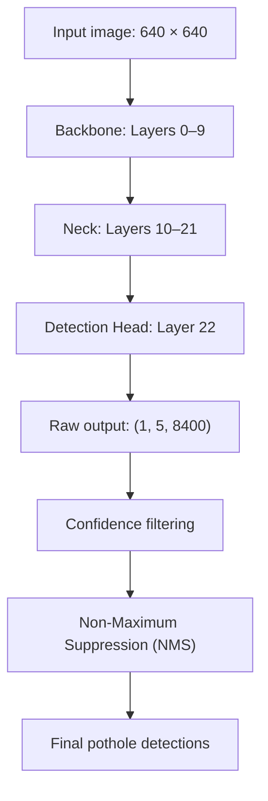

# S3 — YOLOv8 Architecture, NMS and Compute Analysis

## 1. NMS Fundamentals

### What is NMS?

NMS stands for **Non-Maximum Suppression**.

YOLO can predict multiple overlapping bounding boxes for the same object. NMS removes duplicate detections and keeps the strongest prediction.

In TransitNexus, the detected object class is **Potholes**.

### Three Important NMS Concepts

**A. Confidence Threshold**

Every predicted bounding box has a confidence score. The confidence threshold decides which predictions are worth keeping.

Example: confidence threshold = 0.25.

| Detection | Confidence | Decision |
|---|---:|---|
| A | 0.95 | Keep |
| B | 0.82 | Keep |
| C | 0.18 | Reject |

Predictions below the threshold are filtered out before NMS.

**B. IoU Threshold**

IoU means **Intersection over Union**. It measures the overlap between two bounding boxes.

\[
IoU = \frac{\text{Intersection Area}}{\text{Union Area}}
\]

Example:
- Box A and Box B overlap heavily.
- Their IoU is 0.90.
- The configured NMS IoU threshold is 0.70.
- The lower-confidence box is suppressed.

A higher IoU indicates greater overlap.

**C. Per-Class Suppression**

NMS is generally applied separately for each object class.

For example, a person detection should not normally suppress a car detection just because their boxes overlap.

TransitNexus currently has one class:
- Class 0: Potholes

Therefore, all candidate pothole detections are considered within the same class during class-aware NMS.

### Why Can NMS Take Time on CPU?

1. The detection head can produce thousands of candidate boxes.
2. Confidence filtering removes low-scoring candidates.
3. Remaining boxes are sorted by confidence.
4. NMS calculates box overlaps using IoU.
5. Lower-confidence overlapping boxes are suppressed.

Sorting, indexing and repeated overlap calculations can add CPU processing overhead, especially when many candidates survive confidence filtering.

### Why Is NMS Less Straightforward to Batch?

The number of detections that survive NMS can vary by image.

For example:
- Image A: 5 detections
- Image B: 20 detections
- Image C: 2 detections

Neural-network outputs usually have fixed tensor shapes, but post-NMS detection counts can vary. This makes batching the final detection outputs less straightforward.

---

## 2. TransitNexus Model Context

**Verified model:** `models/pothole/best.pt`

| Property | Verified value |
|---|---|
| Architecture | YOLOv8 |
| Classes | 1 — Potholes |
| Input tensor | `(1, 3, 640, 640)` |
| Forward output | `(1, 5, 8400)` |
| Detection strides | 8, 16, 32 |
| Model parameters | 3,011,043 |

The forward output represents 8,400 candidate locations. NMS filters these candidates to produce final detections.

---

## 3. YOLOv8 Architecture Pipeline

The TransitNexus model follows three main architectural stages:

1. **Backbone:** Extracts visual features from the input image.
2. **Neck:** Combines features from multiple spatial scales.
3. **Detection Head:** Produces predictions using the combined features.

The diagram is a grouped representation of the actual model layers. The layer output shapes and final detection output were verified using forward hooks on the actual TransitNexus model.

### Backbone — Layers 0–9

The backbone extracts visual features and progressively reduces the spatial dimensions of the input.

| Layer | Operation | Output shape |
|---|---|---|
| 0 | Conv | `(1,16,320,320)` |
| 1 | Conv | `(1,32,160,160)` |
| 2 | C2f | `(1,32,160,160)` |
| 3 | Conv | `(1,64,80,80)` |
| 4 | C2f | `(1,64,80,80)` |
| 5 | Conv | `(1,128,40,40)` |
| 6 | C2f | `(1,128,40,40)` |
| 7 | Conv | `(1,256,20,20)` |
| 8 | C2f | `(1,256,20,20)` |
| 9 | SPPF | `(1,256,20,20)` |

### Neck — Layers 10–21

The neck combines features from different spatial scales.

| Layers | Operations | Output shape |
|---|---|---|
| 10–12 | Upsample, Concat, C2f | `(1,128,40,40)` |
| 13–15 | Upsample, Concat, C2f | `(1,64,80,80)` |
| 16–18 | Conv, Concat, C2f | `(1,128,40,40)` |
| 19–21 | Conv, Concat, C2f | `(1,256,20,20)` |

The three detection feature maps are:

| Feature map | Layer | Output shape | Locations |
|---|---:|---|---:|
| P3 | 15 | `(1,64,80,80)` | 6,400 |
| P4 | 18 | `(1,128,40,40)` | 1,600 |
| P5 | 21 | `(1,256,20,20)` | 400 |

- **P3:** High-resolution features, useful for smaller objects.
- **P4:** Intermediate-scale features.
- **P5:** Lower-resolution features with larger spatial context.

### Detection Head — Layer 22

The Detect layer receives features from layers `[15, 18, 21]`.

Verified forward output:

`(1, 5, 8400)`

Total locations:

\[
6400 + 1600 + 400 = 8400
\]

For this single-class model, the five output values per location represent four bounding-box coordinates and one class score.

NMS subsequently filters candidate boxes to produce final detections.

### Architecture Interpretation

- Backbone extracts visual features and progressively downsamples the input.
- Neck combines features at multiple spatial scales.
- P3, P4 and P5 provide different levels of spatial detail.
- Detection head combines the three scales to produce predictions.
- NMS removes low-confidence and duplicate detections.

**Evidence:** Layer output shapes and final detection output were directly verified using forward hooks and a 640 × 640 input.

---

## 4. Compute-Cost Profile — 640 × 640

### Verified Model-Level Results

| Metric | Result |
|---|---:|
| Parameters | 3,011,043 (3.011M) |
| THOP total | 4.0958 G MACs |
| Conv2d operations | 4.0414 G MACs |
| Ultralytics model summary | Approximately 8.2 GFLOPs |

THOP reports MACs (Multiply-Accumulate Operations), while the Ultralytics model summary reports GFLOPs. These figures use different reporting conventions and should not be treated as identical measurements.

### Conv2d MAC Distribution

| Component | Layers | MACs | Share |
|---|---|---:|---:|
| Backbone | 0–9 | 1.5778 G | 39.04% |
| Neck | 10–21 | 0.9830 G | 24.32% |
| Detection head | 22 | 1.4806 G | 36.63% |
| Total | — | 4.0414 G | 99.99% |

The total share is 99.99% because of rounding.

### Interpretation and Limitations

- Backbone and detection head account for the largest shares of Conv2d MACs.
- Upsampling and concatenation operations are not represented by Conv2d MAC counts.
- MAC percentages are not runtime percentages.
- NMS and ByteTrack require separate timing measurements.
- ByteTrack belongs to the tracking-enabled application path, not the single-model PyTorch benchmark.

**Evidence:** THOP profiling and PyTorch Conv2d forward hooks at 640 × 640.

---

## 5. NMS and ByteTrack Cost Assessment

### NMS — Ultralytics 8.4.142

**Source:** `ultralytics/utils/nms.py`

NMS processing includes:
- Confidence filtering to remove weak detection candidates.
- IoU-based suppression of overlapping boxes.
- Sorting and processing candidate detections.
- Returning the final detections.

More surviving candidates can increase NMS workload.

TransitNexus uses a single-class pothole model, reducing multi-class complexity.

### ByteTrack — Ultralytics 8.4.142

**Source:** `ultralytics/trackers/byte_tracker.py`

The tracking update pipeline includes:

1. Split detections into high- and low-confidence groups.
2. Initialize detection tracks.
3. Predict existing track positions using a Kalman filter.
4. Associate tracks with high-confidence detections.
5. Associate remaining tracks with low-confidence detections using IoU.
6. Update, create, mark lost and remove tracks.

More detections and active tracks can increase matching workload.

Tracking adds per-frame CPU processing. ByteTrack is not included in the single-model PyTorch benchmark.

### Compute Assessment — Limitations

- Backbone, neck and detection-head percentages represent Conv2d MAC shares only.
- They are not measured runtime percentages.
- NMS and ByteTrack have not been independently timed.
- Separate runtime profiling is required before claiming their actual time shares.
- The single-model benchmark excludes video decoding, tracking, GPS, crop saving and event processing.

**Evidence:** Installed Ultralytics 8.4.142 source inspection and Conv2d forward-hook profiling.

---

## 6. Numerical Time-Breakdown Prediction — 640 × 640

### Measured Reference

| Measurement | Mean latency |
|---|---:|
| PyTorch model-only Run 1 | 47.249 ms |
| PyTorch model-only Run 2 | 46.608 ms |
| Combined model-only mean | 46.929 ms/frame |
| PyTorch end-to-end Run 1 | 47.044 ms/frame |

The model-only path measures the raw neural-network forward pass without NMS or tracking.

The end-to-end measurement starts with an already-decoded BGR frame and includes preprocessing, inference, NMS and Python predictor overhead.

It excludes video decoding, model loading and warm-up.

### Provisional Stage Estimates

The following estimates allocate model-forward latency according to Conv2d MAC shares. They are **not individually measured stage timings**.

| Component | Conv2d MAC share | Estimated time |
|---|---:|---:|
| Backbone | 39.04% | 18.32 ms |
| Neck | 24.32% | 11.41 ms |
| Detection head | 36.63% | 17.19 ms |
| Total | 99.99% | 46.92 ms |

The total is approximately 46.92 ms because the component estimates are rounded.

### NMS and Tracking

- PyTorch `model.predict()` end-to-end Run 1: 47.044 ms/frame.
- This includes preprocessing, inference, NMS and Python predictor overhead.
- NMS runtime has not been isolated.
- ByteTrack runtime has not been measured.
- ByteTrack is outside the single-model benchmark scope.
- No numerical runtime allocation is claimed for NMS or ByteTrack.

### Interpretation

- Backbone and detection head have the largest Conv2d MAC shares.
- MAC share is only a rough proxy for compute distribution.
- Actual stage latency depends on hardware, memory operations and implementation.
- The estimates must not be presented as measured per-layer latency.
- Further profiling is required to isolate NMS and tracking overhead.

**Evidence:** Two PyTorch model-only runs, one end-to-end run, THOP profiling and PyTorch Conv2d forward hooks at 640 × 640.

---

## 7. S3 Final Status

**S3 technical analysis completed.**

| Task | Status |
|---|---|
| NMS fundamentals | Completed |
| YOLOv8 architecture pipeline diagram | Documented |
| Verified intermediate tensor shapes | Completed |
| Backbone, neck and detection-head analysis | Completed |
| Model parameters and compute-cost profile | Completed |
| Conv2d MAC distribution | Completed |
| NMS and ByteTrack cost assessment | Documented |
| Numerical time-breakdown prediction | Completed |
| Measurement limitations and evidence | Documented |

**Important research distinction:** The architecture shapes and model-level compute figures are verified results. The Conv2d stage time breakdown is a provisional estimate, while NMS and ByteTrack runtime remain unmeasured. These distinctions must be preserved in future reports and research claims.